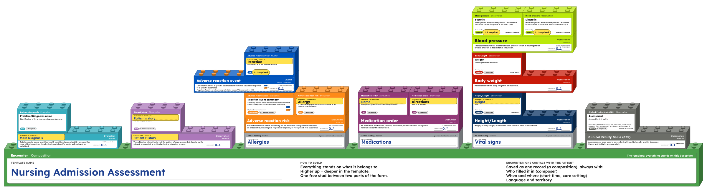

# openEHR building blocks workshop

[](https://doi.org/10.5281/zenodo.23886471)

A paper building-block openEHR template-modelling workshop: participants build the *Nursing
Admission Assessment* template from printed archetype plates and building blocks, then author
a new archetype (*Inpatient admission details*) with write-on blocks. Adapted from Ian McNicoll's
openEHR workshop (see [Credits and licence](#credits-and-licence)). No computers or internet needed
on the day.



Try the online demo: <https://sophiedkk.github.io/datapoort-workshop/> (works on a laptop or a phone).

| Folder | What's in it |
|---|---|
| `handouts/` | The generator, and the print-ready files in `handouts/out/` |
| `archetypes/` | The archetypes and templates (Archetype Designer export) and the decoys |
| `forms/` | Word sources of the two paper forms |

## Running the workshop

The print-ready files are in the repository:

- [Participant handouts](handouts/out/participant_handouts.pdf)
- [Facilitator handouts](handouts/out/facilitator_handouts.pdf)
- [CKM desk](handouts/out/ckm_desk.pdf)
- [Baseplates (A0)](handouts/out/baseplates_A0.pdf)

Start with the first page of the facilitator handouts: it says what to print and how often, and
when to hand out what. Keep that page to yourself, it lists the decoys. The assignment takes the
participants through the exercises. Also bring scissors, pens and label paper for the stickers.

## Changing the materials

Rebuild everything with Podman:

```sh
podman build -t datapoort-handouts .
podman run --rm --userns=keep-id -v "$PWD:/work:Z" datapoort-handouts
```

Commit the files in `handouts/out/` afterwards; pushing `demo.html` to `main` updates the online
demo. See [handouts/README.md](handouts/README.md) for building without a container, the
generator scripts, the demo page and changing a paper form.

## Credits and licence

Adapted from the [openEHR workshop](https://freshehrteam.github.io/openehr-workshop/) by Ian
McNicoll (freshEHR): the exercises are based on his practical modelling tasks, with the additions
the Hanze made for the EHRCON26 version.

© 2026 Sophie de Klerk. Shared under [CC BY-SA 4.0](LICENSE): you may use and adapt the materials,
also for your own workshops, if you credit this repository and Ian McNicoll's workshop and share
your adaptations under the same licence.

Third-party content keeps its own terms:

- The archetypes in `archetypes/`, and their text on the plates and building blocks, come from the
  openEHR Clinical Knowledge Manager (© openEHR Foundation and others, see each `.adl` file),
  under CC BY-SA 4.0.
- The content of the Clinical Frailty Scale is © Geriatric Medicine Research, Dalhousie
  University, and is not covered by this licence. See their
  [terms](https://www.dal.ca/sites/gmr/our-tools/clinical-frailty-scale.html).
- SNOMED CT codes on the building blocks are © SNOMED International.
- The Lexend font, embedded in the PDFs and the demo page, is under the SIL Open Font License.
